# 🏠 Ma Maison — des cartes animées pour Home Assistant

Un tableau de bord sombre et vivant pour Home Assistant : le ciel suit la vraie météo et la position du soleil, les volets bougent selon leur position réelle, le poêle flambe, le ballon chauffe, le robot se promène et les poubelles s'envolent les jours de grand vent.

> 🇬🇧 *A French Home Assistant dashboard made of animated `custom:button-card` cards (weather, shutters, pellet stove, water heater, robot vacuum, bins…). Copy a card's YAML, replace the example entity IDs, done.*

<p align="center">
  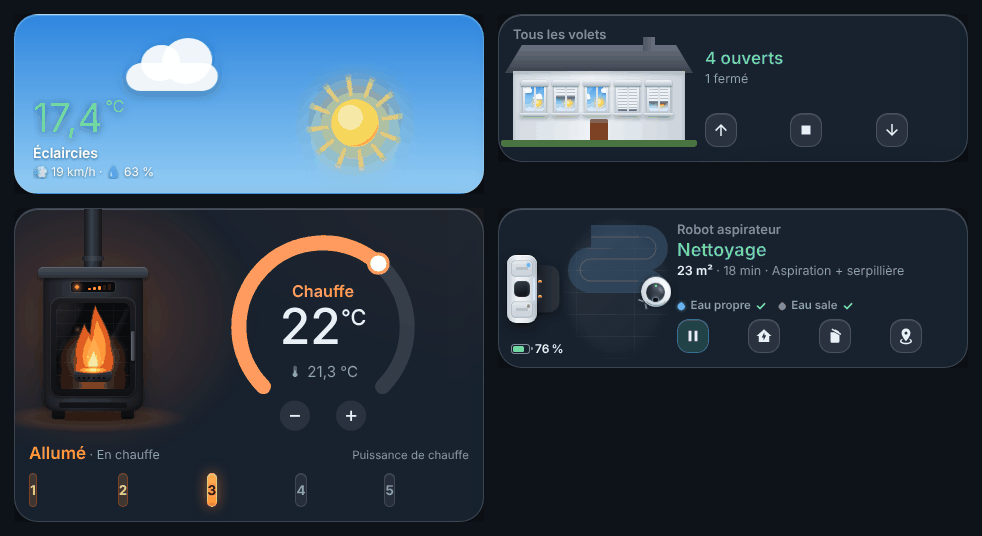
</p>
<p align="center">
  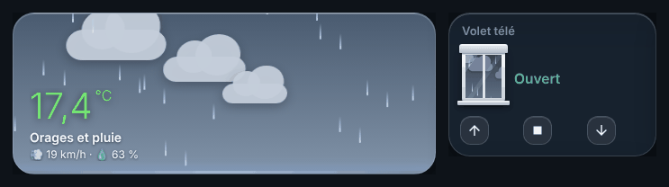
  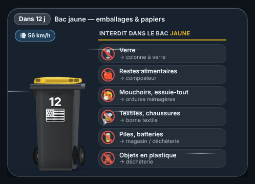
</p>
<p align="center"><sub>Captures réalisées avec des données fictives.</sub></p>

## Démarrage rapide

1. Installez **[button-card](https://github.com/custom-cards/button-card)** depuis HACS.
2. Ouvrez une carte du dossier [`cartes/`](cartes), copiez-la (icône *Copy raw file*), puis dans votre tableau de bord : ✏️ → *Ajouter une carte* → *Manuel* → collez.
3. Remplacez les entités d'exemple indiquées en tête du fichier par les vôtres.

Pour tout installer (thème, package, tableau complet), suivez le **[guide d'installation pas à pas](INSTALLATION.md)**, avec une section dépannage.

Sur iPhone ou sur iPad, deux tableaux tout prêts vous attendent : [versions iPhone et iPad](#versions-iphone-et-ipad).

## Sommaire

- [Aperçu du tableau complet](#aperçu-du-tableau-complet)
- [Versions iPhone et iPad](#versions-iphone-et-ipad)
- [Les cartes](#les-cartes)
- [Installation](#installation) · [guide pas à pas](INSTALLATION.md)
- [Entités à remplacer](#entités-à-remplacer)
- [Personnaliser](#personnaliser)
- [Crédits](#crédits)

## Aperçu du tableau complet

Vue *Sections* sur 3 colonnes, thème `maison_nuit` :

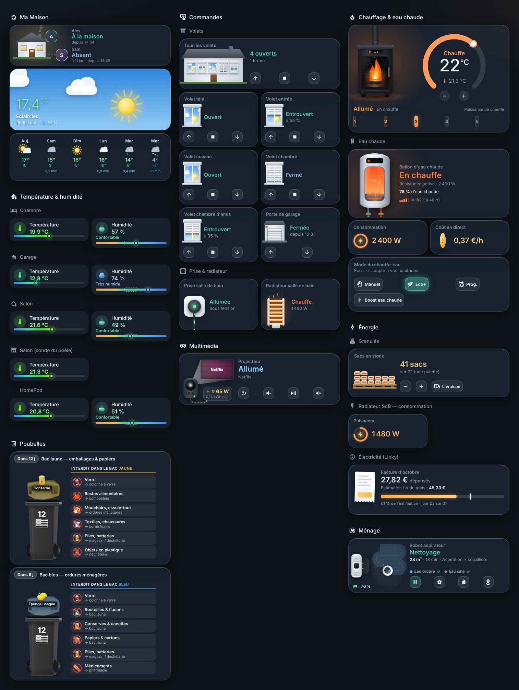

Les graphiques sur 24 h, les statistiques Linky et la caméra sont des cartes natives de Home Assistant : elles font partie du [tableau complet](dashboard/ma-maison.yaml) mais n'apparaissent pas sur cette capture.

## Versions iPhone et iPad

Les mêmes cartes, réorganisées pour le tactile en cinq onglets : **Accueil**, **Commandes**, **Chauffage**, **Climat** et **Énergie**. Une barre d'onglets en bas de l'écran permet de passer de l'un à l'autre au pouce.

| Fichier | Réglé pour | Mise en page |
|---|---|---|
| [`dashboard/ma-maison-iphone.yaml`](dashboard/ma-maison-iphone.yaml) | **iPhone 18 Pro Max** (440 × 956 points) | une colonne, l'essentiel en haut de chaque onglet |
| [`dashboard/ma-maison-ipad.yaml`](dashboard/ma-maison-ipad.yaml) | **iPad M1 en portrait** (iPad Air 5 : 820 × 1180 points ; iPad Pro 11 po : 834 × 1194) | deux colonnes ; chaque onglet tient sur un seul écran, pratique pour un iPad posé en écran central de la maison |

<p align="center">
  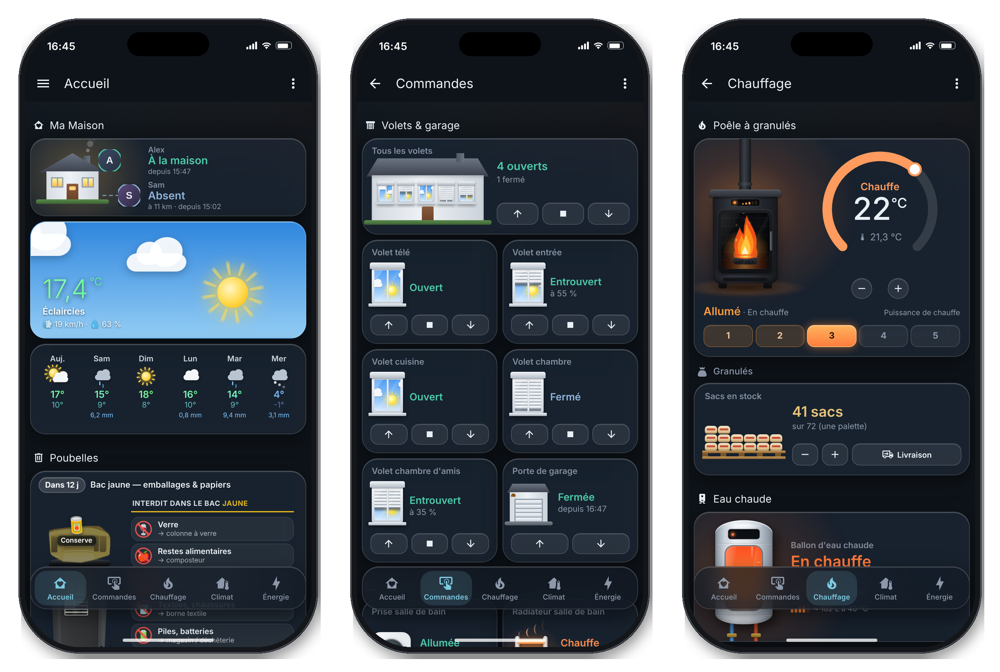
</p>
<p align="center">
  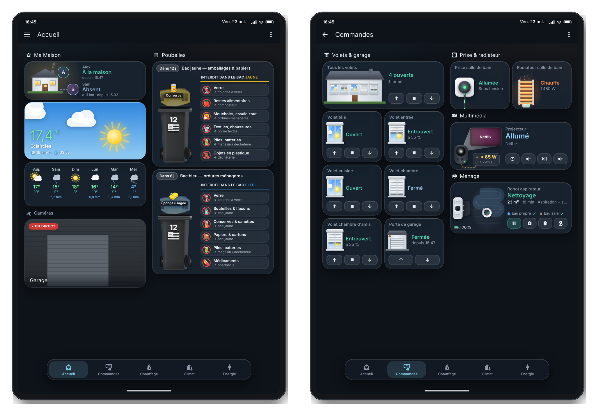
</p>

Ils fonctionnent aussi sur les autres iPhone et iPad : sur un écran plus petit, il faut simplement faire défiler un peu plus.

Deux réglages en plus par rapport au tableau complet : les boutons des cartes occupent toute la place prévue pour eux (plus faciles à toucher), et les petites cartes Température et Humidité remplissent leur case.

**Installation** : créez un tableau de bord vide nommé « Ma Maison iPhone » (ou « Ma Maison iPad »). Home Assistant remplit son adresse d'après le titre : elle doit être `ma-maison-iphone` (ou `ma-maison-ipad`), car la barre d'onglets l'utilise. Ouvrez-le, puis ✏️ → ⋮ → *Éditeur de configuration brute* et collez le fichier. Avec une autre adresse, remplacez `/ma-maison-iphone/` (ou `/ma-maison-ipad/`) partout dans le fichier.

## Les cartes

Chaque fichier du dossier [`cartes/`](cartes) est une carte prête à coller. En tête de fichier : ce qu'elle fait, les entités à remplacer et ce dont elle a besoin.

| Aperçu | Carte |
|:--:|---|
| 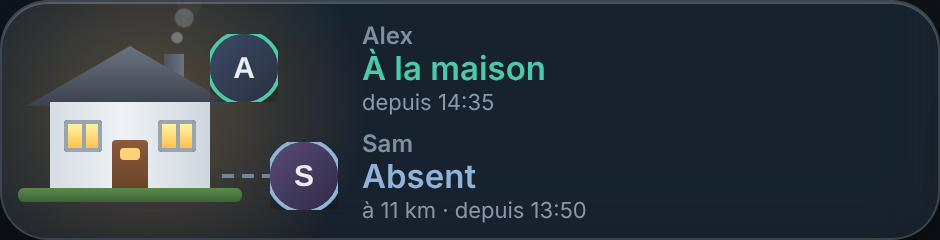 | **Présence** · [`01-presence.yaml`](cartes/01-presence.yaml)<br>Maison animée (fumée, fenêtres allumées) qui s'éclaire quand quelqu'un est là. Deux personnes : avatar, statut, distance de la maison, heure du dernier changement.<br><sub>Nécessite : button-card (HACS)</sub> |
| 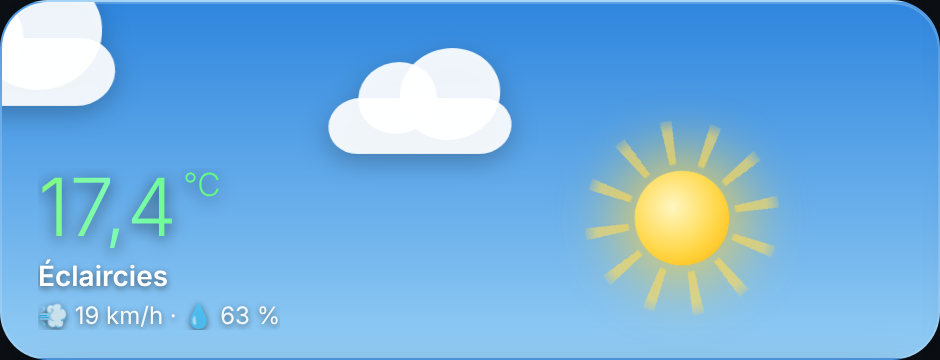 | **Météo** · [`02-meteo.yaml`](cartes/02-meteo.yaml)<br>Ciel animé selon la météo actuelle et l'heure (soleil, nuages, pluie, neige, orage, brouillard, vent, nuit étoilée), avec température et détails.<br><sub>Nécessite : button-card (HACS)</sub> |
| 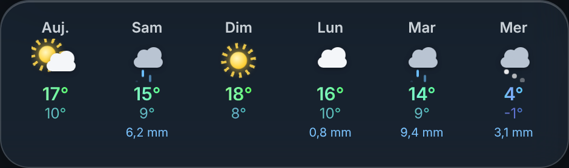 | **Prévisions de la semaine** · [`03-previsions.yaml`](cartes/03-previsions.yaml)<br>Prévisions sur 6 jours avec icônes animées, mini / maxi, pluie et vent.<br><sub>Nécessite : button-card (HACS) + input_text.meteo_previsions_semaine et son automatisation (package)</sub> |
| 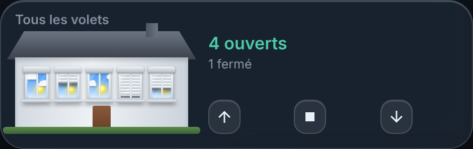 | **Tous les volets (façade)** · [`04-volets-facade.yaml`](cartes/04-volets-facade.yaml)<br>Façade avec 5 fenêtres : chaque volet suit sa vraie position et, volets ouverts, le ciel derrière les vitres suit le soleil réel et la météo (nuages, pluie, orage, neige, nuit). Boutons monter / stop / descendre pour tous les volets.<br><sub>Nécessite : button-card (HACS) + un groupe de volets (cover.tous_les_volets)</sub> |
| 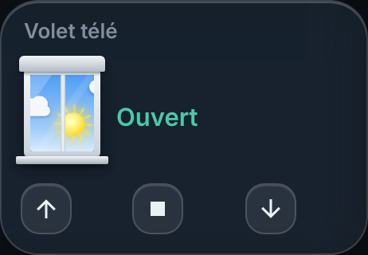 | **Volet** · [`05-volet.yaml`](cartes/05-volet.yaml)<br>Une fenêtre et son volet animé (position, mouvement), avec le même ciel animé et les boutons monter / stop / descendre. Dupliquez la carte pour chaque volet.<br><sub>Nécessite : button-card (HACS)</sub> |
| 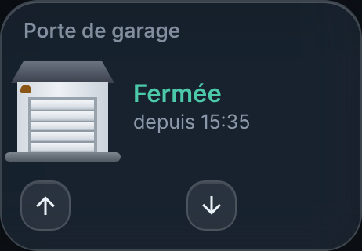 | **Porte de garage** · [`06-porte-garage.yaml`](cartes/06-porte-garage.yaml)<br>Porte de garage animée (ouverture, fermeture, état) avec boutons ouvrir / fermer.<br><sub>Nécessite : button-card (HACS)</sub> |
| 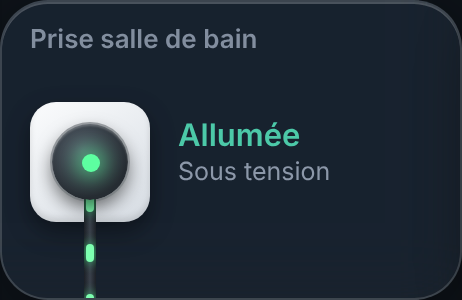 | **Prise connectée** · [`07-prise.yaml`](cartes/07-prise.yaml)<br>Prise animée : appui = marche / arrêt, appui long = détails.<br><sub>Nécessite : button-card (HACS)</sub> |
| 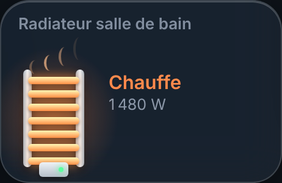 | **Radiateur sur prise** · [`08-radiateur.yaml`](cartes/08-radiateur.yaml)<br>Radiateur branché sur une prise qui mesure la puissance : animation de chauffe quand il consomme (Chauffe / En veille / Éteint). Appui = marche / arrêt.<br><sub>Nécessite : button-card (HACS) + une prise avec mesure de puissance</sub> |
| 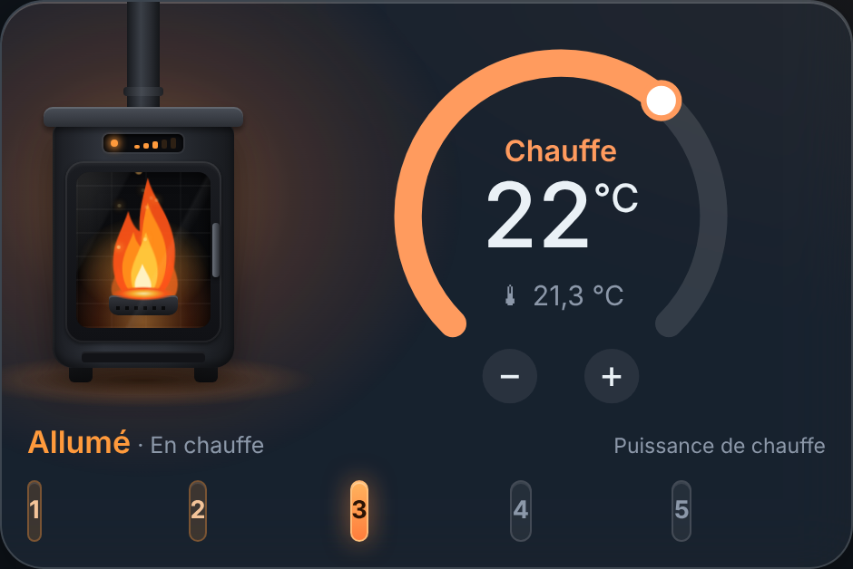 | **Poêle à granulés** · [`09-poele-granules.yaml`](cartes/09-poele-granules.yaml)<br>Poêle animé (flammes, braises, étincelles selon la puissance), état, consigne et alarmes.<br><sub>Nécessite : button-card (HACS) + un poêle intégré à Home Assistant (climate + capteurs)</sub> |
| 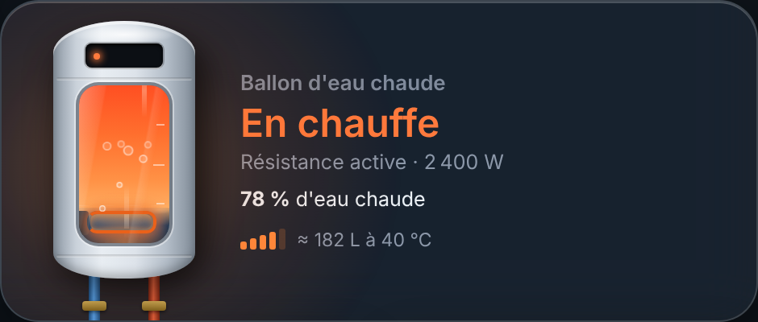 | **Ballon d'eau chaude** · [`10-ballon-eau-chaude.yaml`](cartes/10-ballon-eau-chaude.yaml)<br>Ballon animé : eau chaude disponible, chauffe en cours, boost, absence, erreurs.<br><sub>Nécessite : button-card (HACS) + chauffe-eau Atlantic Cozytouch (intégration HACS cozytouch)</sub> |
| 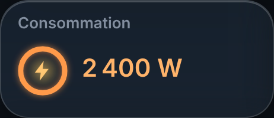 | **Puissance instantanée** · [`11-puissance.yaml`](cartes/11-puissance.yaml)<br>Consommation électrique en direct (W) avec jauge animée. Même carte pour le chauffe-eau et le radiateur : changez l'entité, le libellé « Consommation » écrit dans le champ info, et la pleine échelle de la jauge (w / 2400).<br><sub>Nécessite : button-card (HACS)</sub> |
| 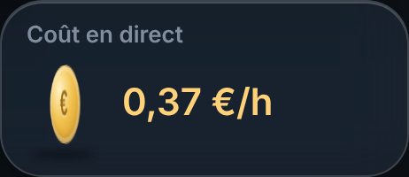 | **Coût en direct** · [`12-cout-en-direct.yaml`](cartes/12-cout-en-direct.yaml)<br>Ce que coûte l'appareil en ce moment, en €/h (tarif heures pleines / creuses).<br><sub>Nécessite : button-card (HACS) + capteur sensor.chauffe_eau_cout_horaire (package)</sub> |
| 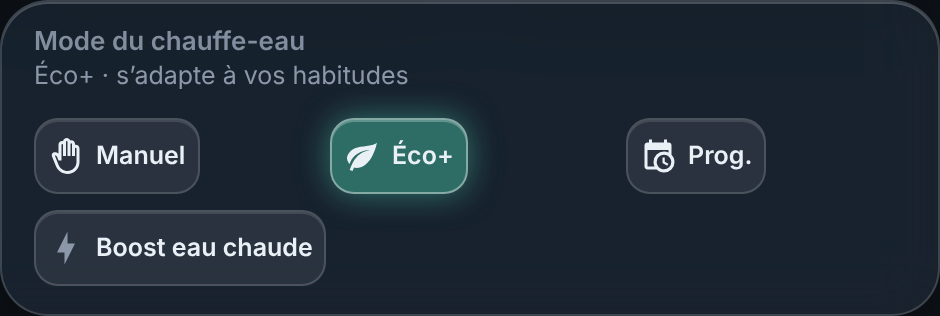 | **Mode du chauffe-eau** · [`13-mode-chauffe-eau.yaml`](cartes/13-mode-chauffe-eau.yaml)<br>Choix du mode (Manuel, Éco+, Programmé) en un appui, et bouton Boost.<br><sub>Nécessite : button-card (HACS) + chauffe-eau Atlantic Cozytouch</sub> |
| 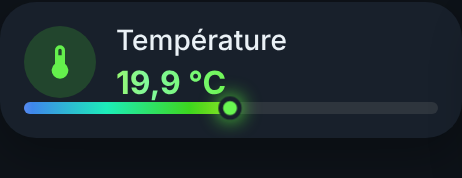 | **Température** · [`14-temperature.yaml`](cartes/14-temperature.yaml)<br>Thermomètre animé avec la température de la pièce. Dupliquez-la pour chaque capteur.<br><sub>Nécessite : button-card (HACS)</sub> |
| 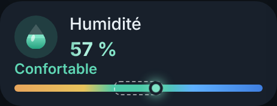 | **Humidité** · [`15-humidite.yaml`](cartes/15-humidite.yaml)<br>Goutte animée avec le taux d'humidité et un avis (air sec, confortable, humide…).<br><sub>Nécessite : button-card (HACS)</sub> |
| 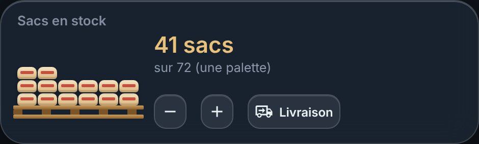 | **Stock de sacs de granulés** · [`16-sacs-granules.yaml`](cartes/16-sacs-granules.yaml)<br>Stock de sacs avec boutons − (sac versé), + et « Livraison » (palette livrée), alerte stock bas.<br><sub>Nécessite : button-card (HACS) + counter.sacs_de_granules (package)</sub> |
| 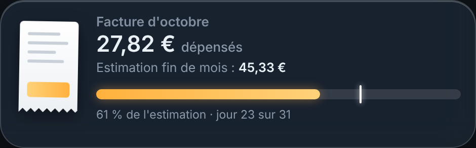 | **Facture d'électricité du mois** · [`17-facture-electricite.yaml`](cartes/17-facture-electricite.yaml)<br>Estimation de la facture du mois et dépense à date, calculées depuis le Linky et vos tarifs.<br><sub>Nécessite : button-card (HACS) + intégration ha-linky + entrées « Électricité » et leur automatisation (package)</sub> |
| 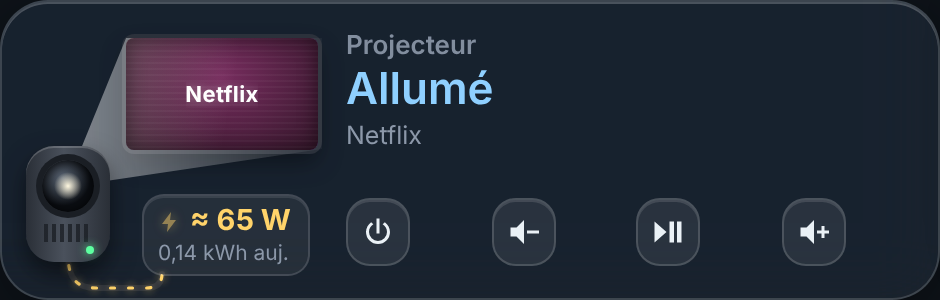 | **Vidéoprojecteur** · [`18-projecteur.yaml`](cartes/18-projecteur.yaml)<br>Écran animé qui s'allume avec l'appli en cours, lecture / pause, volume, marche / arrêt et consommation estimée du jour.<br><sub>Nécessite : button-card (HACS) + Android TV Remote et Google Cast + capteurs projecteur (package)</sub> |
| 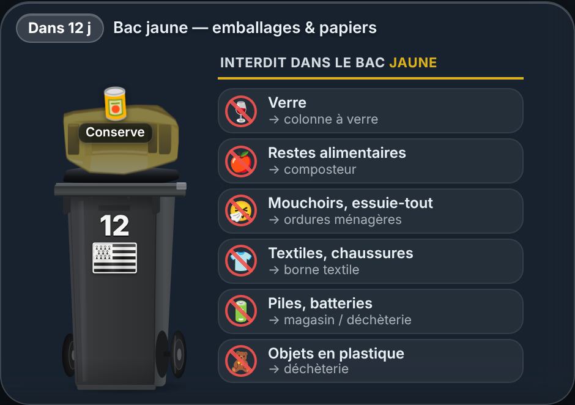 | **Poubelle jaune (emballages)** · [`19-poubelle-jaune.yaml`](cartes/19-poubelle-jaune.yaml)<br>Compte à rebours jusqu'à la prochaine collecte, alerte la veille, report des jours fériés, envol animé du bac quand il y a du vent ; appui = « bac rangé à l'abri » pour la journée.<br><sub>Nécessite : button-card (HACS) + vent max prévu, input_datetime et script poubelle (package)</sub> |
| 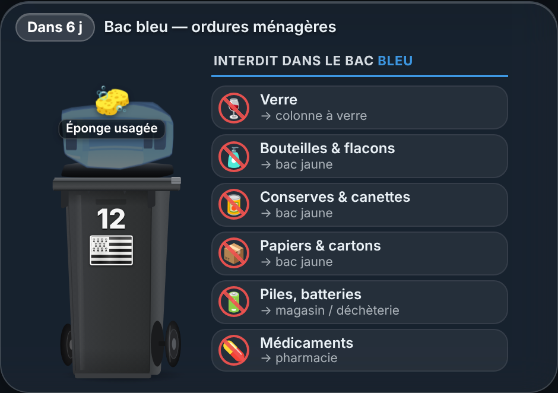 | **Poubelle bleue (ordures ménagères)** · [`20-poubelle-bleue.yaml`](cartes/20-poubelle-bleue.yaml)<br>Même principe que la poubelle jaune, avec son propre calendrier et son animation.<br><sub>Nécessite : button-card (HACS) + vent max prévu, input_datetime et script poubelle (package)</sub> |
| 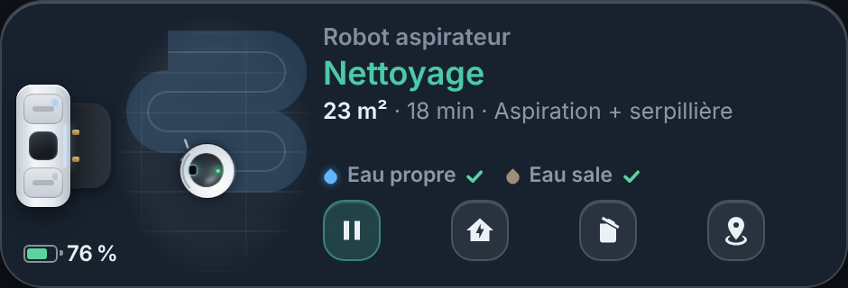 | **Robot aspirateur** · [`21-robot-aspirateur.yaml`](cartes/21-robot-aspirateur.yaml)<br>Robot animé selon son état (nettoyage, retour, vidage, lavage, séchage, charge), batterie, réservoirs, erreurs en clair ; boutons démarrer, pause, base, localiser, vider le bac.<br><sub>Nécessite : button-card (HACS) + robot Ecovacs Deebot (Matter + intégration Ecovacs)</sub> |

## Installation

Téléchargez le dépôt avec le bouton vert **Code → Download ZIP**, ou copiez seulement les fichiers qui vous intéressent. Première fois avec Home Assistant ? Le **[guide pas à pas](INSTALLATION.md)** détaille chaque clic.

### 1. Prérequis

- **Home Assistant** récent (testé sur **2026.10**), pour la vue *Sections* et les cartes *Titre*.
- **[HACS](https://hacs.xyz)** avec :
  - **[button-card](https://github.com/custom-cards/button-card)** (testé en 7.x) : toutes les cartes animées ;
  - **[card-mod](https://github.com/thomasloven/lovelace-card-mod)** : uniquement pour habiller les cartes natives (graphiques, statistiques, caméra…).

### 2. Le thème `maison_nuit` (conseillé)

Les cartes ont leurs propres couleurs, mais elles sont pensées pour ce fond ardoise.

1. Copiez [`configuration/themes/maison_nuit.yaml`](configuration/themes/maison_nuit.yaml) dans `/config/themes/`.
2. Dans `configuration.yaml`, une seule fois :
   ```yaml
   frontend:
     themes: !include_dir_merge_named themes
   ```
3. Redémarrez Home Assistant. Le thème est défini pour le **mode sombre**.

### 3. Le package : entrées, capteurs et automatisations

Certaines cartes s'appuient sur des entrées et des automatisations. Tout est réuni dans un seul fichier :

1. Dans `configuration.yaml`, une seule fois :
   ```yaml
   homeassistant:
     packages: !include_dir_named packages
   ```
2. Copiez [`configuration/packages/ma_maison.yaml`](configuration/packages/ma_maison.yaml) dans `/config/packages/`.
3. Adaptez les entités listées en tête du fichier, vérifiez la configuration (*Outils → YAML*), puis redémarrez.
4. Saisissez vos tarifs dans les entrées « Électricité – prix HP », « prix HC », « abonnement » et « part heures creuses » (*Paramètres → Appareils et services → Entrées*, puis cliquez sur l'entrée), ainsi que la puissance de votre ballon dans « Chauffe-eau puissance nominale ». Elles démarrent au minimum (0, ou 500 W pour le ballon).

Vous n'utilisez qu'une partie des cartes ? Supprimez les blocs inutiles du package.

| Carte | Ce qu'il lui faut dans le package |
|---|---|
| Prévisions de la semaine | `input_text.meteo_previsions_semaine` + automatisation « prévisions de la semaine » |
| Poubelles | `input_number.vent_max_prevu_24_h` + automatisation « vent max », `input_datetime.bac_jaune_a_l_abri` / `bac_bleu_a_l_abri`, `script.poubelle_a_l_abri` |
| Facture d'électricité | entrées `input_number.electricite_*` + automatisation « facture du mois » (et l'intégration [ha-linky](https://github.com/bokub/ha-linky)) |
| Puissance et coût du chauffe-eau | `sensor.chauffe_eau_puissance`, `sensor.chauffe_eau_cout_horaire`, `input_number.chauffe_eau_puissance_nominale` |
| Sacs de granulés | `counter.sacs_de_granules` |
| Vidéoprojecteur | `sensor.projecteur_puissance_estimee`, `sensor.projecteur_energie_aujourd_hui` |
| Température / humidité du HomePod | `input_text.homepod_temperature`, `input_text.homepod_humidite` + automatisation « relevé HomePod » (webhook) |

### 4. Ajouter les cartes

**Tout le tableau d'un coup** : créez un tableau de bord vide (*Paramètres → Tableaux de bord → Ajouter un tableau de bord → Nouveau tableau de bord à partir de zéro*), ouvrez-le, puis ✏️ → ⋮ → *Éditeur de configuration brute* et collez [`dashboard/ma-maison.yaml`](dashboard/ma-maison.yaml).

**Pour un iPhone ou un iPad** : même méthode avec [`dashboard/ma-maison-iphone.yaml`](dashboard/ma-maison-iphone.yaml) ou [`dashboard/ma-maison-ipad.yaml`](dashboard/ma-maison-ipad.yaml), dans un tableau nommé « Ma Maison iPhone » ou « Ma Maison iPad » (voir [Versions iPhone et iPad](#versions-iphone-et-ipad)).

**Ou carte par carte** : ✏️ *Modifier le tableau de bord* → *Ajouter une carte* → *Manuel*, puis collez le contenu d'un fichier de [`cartes/`](cartes).

Il reste à remplacer les entités d'exemple par les vôtres (Ctrl/Cmd + F dans l'éditeur).

## Entités à remplacer

Les noms d'entités sont des exemples. Remplacez-les par les vôtres, dans les cartes comme dans le package.

| Entité d'exemple | À remplacer par |
|---|---|
| `person.personne_1`, `person.personne_2` | les deux personnes du foyer |
| `zone.home`, `sun.sun` | présentes par défaut dans Home Assistant |
| `weather.forecast_maison` | votre météo (Met.no crée `weather.forecast_<nom de la maison>`) |
| `cover.tous_les_volets` | un groupe de volets (*Paramètres → Entrées → Groupe → Volet*) |
| `cover.salon_volet_tele`, `cover.salon_volet_entree`, `cover.cuisine_volet_cuisine`, `cover.chambre_volet_chambre`, `cover.chambre_damis_volet_chambre_damis` | vos volets, avec leur position |
| `cover.porte_de_garage` | votre porte de garage |
| `switch.prise_salle_de_bain` | une prise connectée |
| `switch.radiateur_salle_de_bain`, `sensor.radiateur_salle_de_bain_puissance` | une prise qui mesure la puissance d'un radiateur |
| `climate.salon_poele_a_granules`, `sensor.salon_poele_a_granules_*`, `number.salon_poele_a_granules_power` | votre poêle à granulés (voir [Personnaliser](#personnaliser)) |
| `sensor.domestic_hot_water_*`, `switch.domestic_hot_water_boost_eau_chaude`, `select.domestic_hot_water_mode_eau_chaude` | un chauffe-eau Atlantic piloté par Cozytouch |
| `sensor.chambre_temperature`, `sensor.chambre_humidite`, `sensor.garage_*`, `sensor.salon_temperature`, `sensor.salon_humidite`, `sensor.salon_poele_a_granules_air_temperature` | vos capteurs de température et d'humidité |
| `input_text.homepod_temperature`, `input_text.homepod_humidite` | la température et l'humidité d'un HomePod, envoyées par un raccourci Apple (voir [Personnaliser](#personnaliser)) |
| `linky:00000000000000` | la statistique de votre compteur Linky ([ha-linky](https://github.com/bokub/ha-linky)) |
| `media_player.projecteur`, `media_player.projecteur_cast` | votre vidéoprojecteur ou TV Android (Android TV Remote) et son entité Google Cast |
| `vacuum.robot_aspirateur`, `sensor.robot_aspirateur_*`, `select.robot_aspirateur_mode_nettoyage` | un robot Ecovacs Deebot vu par Matter |
| `vacuum.robot_nettoyeur`, `sensor.robot_nettoyeur_*`, `button.robot_nettoyeur_vider_le_bac_a_poussiere` | le même robot, via l'intégration Ecovacs |
| `camera.garage` | une caméra |

## Personnaliser

- **Poubelles** : le calendrier est sur la première ligne du champ `head` de chaque carte, par exemple `const DAYS=[2], W=1, H=7, MODE="report";`. `DAYS` : jours de collecte (0 = lundi … 6 = dimanche, plusieurs jours possibles : `[1, 3]`) ; `W` : `1` = semaines impaires, `0` = paires, `null` = toutes ; `H` : heure de passage ; `MODE` : `"report"` décale la collecte après un jour férié, `"aucun"` ne décale pas. Le bac s'envole quand le vent prévu atteint 50 km/h ; un appui sur la carte le déclare « rangé à l'abri » pour la journée.
- **Poêle à granulés** : la carte lit les statuts `OFF`, `PELLET LOAD`, `AWAITING FLAME`, `LIGHTING`, `WORKING`, `ASHPAN CLEANING`, `STANDBY`, `FINAL CLEANING`, `ALARM` et `ALARM MEMORY`. Si votre poêle en renvoie d'autres, adaptez le tableau `P` de la variable `pf`. Sans statut reconnu, la carte se rabat sur l'état de l'entité `climate`.
- **Sacs de granulés** : alerte « stock bas » à 6 sacs ou moins. La carte affiche le stock « sur » le `maximum` du compteur (72, une palette) et le bouton « Livraison » remet le compteur à sa valeur `initial` (72 dans le package).
- **Humidité** : air sec sous 35 %, confortable jusqu'à 60 %, un peu humide jusqu'à 70 %, très humide au-delà.
- **Chauffe-eau** : la puissance affichée et le coût en direct viennent de `input_number.chauffe_eau_puissance_nominale` : saisissez celle de votre ballon (souvent 1 500 à 3 000 W, indiquée sur sa plaque).
- **HomePod** : Home Assistant ne lit pas directement les capteurs du HomePod. Dans l'app Raccourcis (ou Maison), créez une automatisation, par exemple à heure fixe ou quand la température de la pièce change, qui récupère la température et l'humidité mesurées par le HomePod et les envoie en `POST` JSON `{"temperature": 20.5, "humidite": 48}` à `https://<votre-home-assistant>/api/webhook/<votre-identifiant>`. Remplacez `homepod-remplacez-moi` dans le package par un identifiant aléatoire et gardez-le secret : il sert de clé.
- **Numéro sur les poubelles** : remplacez `12` dans `<span class="jnum">12</span>` (bac jaune) et `<span class="bnum">12</span>` (bac bleu), ainsi que `n° 12` dans le titre du drapeau, par votre propre numéro.
- **Titres des cartes** : le titre affiché est écrit dans le HTML de la carte (champ `info` ou `head`) ; modifier `name:` ne suffit pas, cherchez le texte dans la carte et remplacez-le.

## Crédits
- Damien Joulou-Bénardeau
- Style inspiré des tableaux de bord de [TechEnClair](https://github.com/mirasandalucia/TechEnClair) (licence MIT).
- Construit avec [button-card](https://github.com/custom-cards/button-card) et [card-mod](https://github.com/thomasloven/lovelace-card-mod) ; icônes [Material Design Icons](https://pictogrammers.com/library/mdi/).
- Conçu avec l'aide de Claude (Anthropic).

## Licence

[MIT](LICENSE) : libre de copier, modifier et partager.
